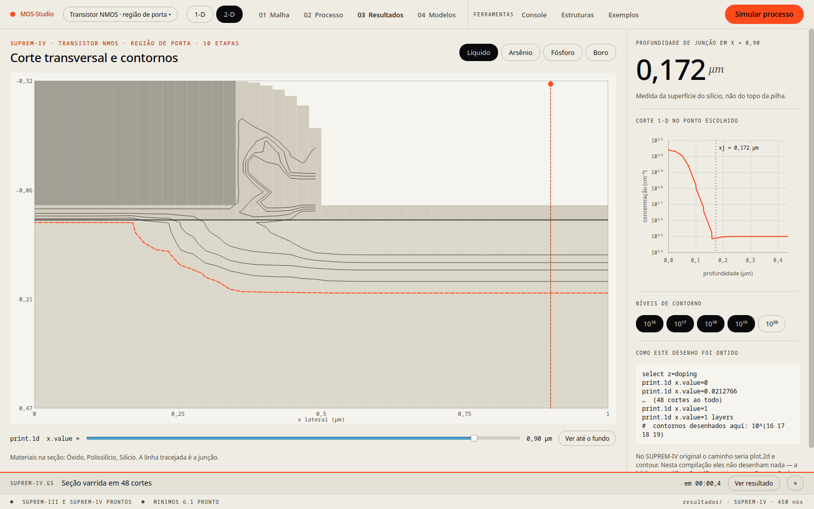
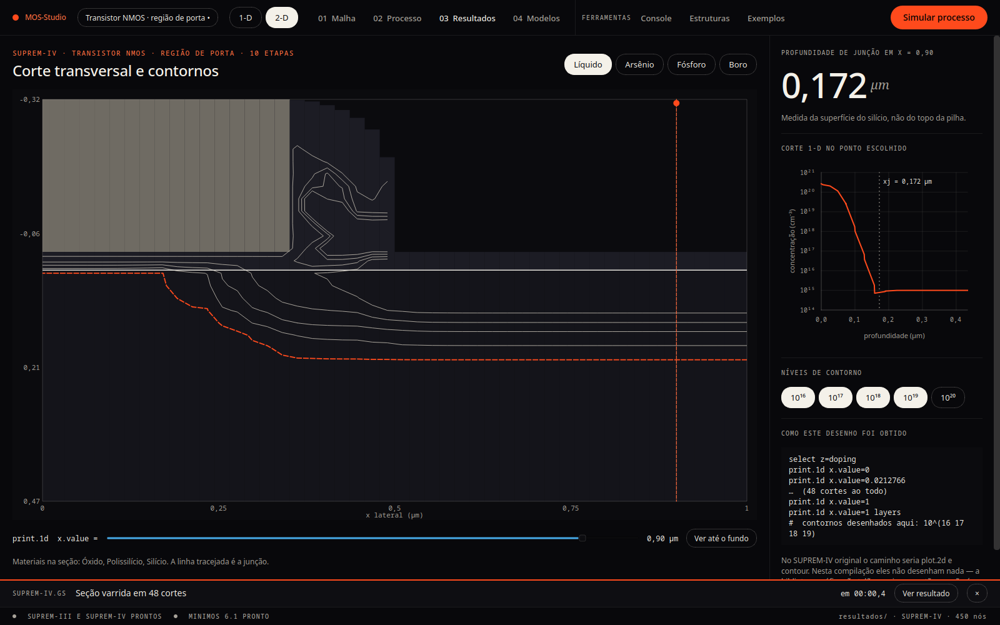

# MOS-Studio

Aplicativo de bancada para **simulação de processos e dispositivos
semicondutores**. Monta a receita de fabricação etapa por etapa — substrato,
oxidação, implantação, difusão, corrosão, deposição —, roda os simuladores de
Stanford e da TU Wien, e mostra o que saiu dali: perfil de dopagem,
profundidade de junção, pilha de camadas, seção transversal 2-D e a curva I-V
do transistor. Desktop, PySide6. Nada de web.

Três motores, uma interface só:

| Motor | O que faz | Origem |
|---|---|---|
| **SUPREM-III** Release B (rev. 8628) | processo em **1-D**: perfil em profundidade | Stanford, 1986 — Fortran |
| **SUPREM-IV.GS** B.9305 | processo em **2-D**: a seção transversal inteira | Stanford / Univ. da Flórida, 1993 — C |
| **MINIMOS 6.1** | **dispositivo**: curva I-V e mapas de campo | TU Wien — Fortran |

O perfil que o SUPREM calcula vira a dopagem do deck do MINIMOS sem passar
por nenhum arquivo intermediário editado à mão.

## Estado

- **Linux e Windows: os três motores funcionam.** No Linux o `instalar.sh`
  instala as dependências e compila os motores sozinho; no Windows o
  instalador `.exe` já traz o SUPREM-III e o SUPREM-IV compilados.
- **O MINIMOS é a exceção, por licença**: a TU Wien o distribui de graça só
  a usuários registrados e não permite repassá-lo. Quem tem o
  `minimoswin6.1.zip` o instala com um clique na tela de Dispositivo (ou
  `./instalar.sh --minimos ZIP`). Ver [Os motores](#os-motores-e-como-obtê-los).
- Versão publicada: **v2.1.0**, com instalador de Windows e pacote de Linux
  em [Releases](https://github.com/phareon-corp/MOS-Studio/releases).
- Suíte: **857 testes**. Boa parte sobe o motor de verdade, e se auto-pula
  quando ele não está instalado.

|  |  |
|---|---|
| Resultados 2-D, terreno **claro** — o padrão | a mesma tela no terreno **escuro** |

As doze telas nos dois terrenos estão em [`docs/img/`](docs/img/), e são
geradas pelo próprio programa (`--capturar`, ver [Usar](#usar)) — não há
recorte feito à mão que possa envelhecer sem ninguém notar.

---

## Sumário

- [Requisitos](#requisitos)
- [Instalar](#instalar)
- [Os motores, e como obtê-los](#os-motores-e-como-obtê-los)
- [Usar](#usar)
  - [As duas dimensões](#as-duas-dimensões)
  - [As doze telas](#as-doze-telas)
- [O que o motor faz, e o que ele finge fazer](#o-que-o-motor-faz-e-o-que-ele-finge-fazer)
- [Quando dá errado](#quando-dá-errado)
- [Limitações conhecidas](#limitações-conhecidas)
- [Onde ficam as coisas](#onde-ficam-as-coisas)
- [Arquitetura](#arquitetura)
- [Testes](#testes)
- [Windows](#windows)
- [Empacotar](#empacotar)
- [Design](#design)
- [Créditos e licença](#créditos-e-licença)

## Requisitos

| O quê | Detalhe |
|---|---|
| Sistema | **Linux** x86-64 (Fedora, Ubuntu/Debian, Arch, openSUSE), ou **Windows 10/11** 64 bits |
| Linux | Python **≥ 3.10** e `sudo`. O resto — compiladores C e Fortran, bibliotecas do Qt, PySide6 — o `instalar.sh` instala |
| Windows | nada: o instalador traz Python, Qt e os motores |
| Rede | só na instalação (pacotes do sistema e o PySide6, ~100 MB) |

Sem motor nenhum o programa **abre e navega**: cada tela diz qual motor falta
e por quê, em vez de falhar só na hora de rodar.

## Instalar

### Linux — um comando

```sh
git clone https://github.com/phareon-corp/MOS-Studio.git
cd MOS-Studio
./instalar.sh
```

(ou baixe `mos-studio-2.1.0-linux.tar.gz` em
[Releases](https://github.com/phareon-corp/MOS-Studio/releases), extraia e
rode `./instalar.sh` lá dentro — é o mesmo conteúdo.)

O instalador faz tudo, em cinco etapas, e pode ser rodado de novo sem medo —
o que já está pronto é pulado:

1. **dependências do sistema** — compiladores C e Fortran, `make`, `patch` e
   as bibliotecas que o Qt 6 carrega para abrir a janela (a `xcb-cursor` é a
   que mais falta). Usa o gerenciador da distribuição (dnf, apt, pacman ou
   zypper) e só pede a senha se faltar alguma coisa;
2. **Python e PySide6** num ambiente próprio, em
   `~/.local/share/mos-studio/venv`. Não usa `pip install --user`, que o
   Ubuntu e o Debian recentes recusam (PEP 668);
3. **os motores**, compilados do fonte que vem em [`fontes/`](fontes/):
   SUPREM-IV.GS e SUPREM-III; e o MINIMOS, se houver o
   `minimoswin6.1.zip` em `~/Downloads` (ou com `--minimos ZIP`);
4. **lançador, menu e ícone** no perfil do usuário;
5. **conferência**: monta a janela inteira sem mostrá-la e confere os
   motores. Os registros de cada etapa ficam em
   `~/.local/share/mos-studio/logs/`.

| Opção | O que faz |
|---|---|
| `--minimos ZIP` | instala o MINIMOS a partir do zip da TU Wien |
| `--recompilar` | compila os motores de novo |
| `--sem-sistema` | não chama o gerenciador de pacotes (sem sudo) |

| O que fica instalado | Onde |
|---|---|
| Lançador `mos-studio` | `~/.local/bin/` |
| Entrada de menu | `~/.local/share/applications/io.syncfield.MosStudio.desktop` |
| Ícone | `~/.local/share/icons/hicolor/scalable/apps/` |
| Python + PySide6 | `~/.local/share/mos-studio/venv/` |
| Motores | `suprem-run/`, `suprem4-run/`, `minimos-run/` nesta pasta |

O lançador **aponta para esta pasta** em vez de copiar o programa: os motores
e o histórico de execuções vivem aqui. Mover ou renomear a pasta quebra o
lançador — basta rodar `./instalar.sh` de novo no lugar novo.

`./desinstalar.sh` remove o lançador, o menu, o ícone e o ambiente Python.
Não toca nas preferências (`~/.config/mos-studio`) nem nas simulações.

### Windows — um arquivo

Baixe e rode
[`MOS-Studio-2.1.0-instalador.exe`](https://github.com/phareon-corp/MOS-Studio/releases).
Instala **por usuário**, sem pedir senha de administrador, e aparece em
"Aplicativos instalados" com desinstalador próprio. Não precisa de Python
nem de compilador: o pacote traz o próprio interpretador, a própria
biblioteca gráfica, o **SUPREM-III** e o **SUPREM-IV.GS** já compilados.

Para o MINIMOS: abra a tela **Dispositivo** e clique em **Instalar MINIMOS a
partir do .zip…**, apontando para o `minimoswin6.1.zip`.

O SmartScreen avisa na primeira execução, porque o instalador não é
assinado: "Mais informações" → "Executar assim mesmo".

### Rodar sem instalar

```sh
python -m mos_studio
```

## Os motores, e como obtê-los

| Motor | Licença | Como chega |
|---|---|---|
| SUPREM-IV.GS | Stanford: copiar e distribuir livre, exceto venda | fonte em `fontes/`, compilado pelo instalador (Linux) ou já no `.exe` (Windows) |
| SUPREM-III | a mesma | idem |
| MINIMOS 6.1 | TU Wien: só usuários registrados, sem repasse | **cada usuário traz o próprio zip** |

### SUPREM-III e SUPREM-IV.GS — vêm junto

O código-fonte original dos dois está em [`fontes/`](fontes/), conferido por
SHA-256 — o SUPREM-III como Stanford o publica, o SUPREM-IV com os remendos
da Cogenda, num commit fixo. A nota de licença de Stanford, que permite
copiar, modificar e distribuir exceto comercialmente, está em
[`fontes/LEIA-ME.md`](fontes/LEIA-ME.md). O `instalar.sh` os compila; à mão:

```sh
./build_suprem4.sh     # SUPREM-IV.GS → suprem4-run/
./build_suprem.sh      # SUPREM-III   → suprem-run/
```

O SUPREM-IV leva os cinco remendos de [`patches/suprem4/`](patches/suprem4/):
**quatro defeitos reais de portabilidade** que o Linux perdoava por sorte,
mais um `strcpy` com regiões sobrepostas que a glibc moderna quebra em
silêncio e corrompe todo `foreach`. Cada `.patch` começa explicando o quê e
o porquê; o mais consequente está em
[`docs/adr/0003-versao-de-windows.md`](docs/adr/0003-versao-de-windows.md).

O SUPREM-III recebe correções de portabilidade aplicadas pelo próprio
script (continuações de Fortran 66, `implicit undefined`, arquivos
`scratch`) e é compilado em C89: o GCC 15 compila em C23 por padrão, onde a
declaração antiga `char *getenv();` vira erro.

### MINIMOS 6.1 — do seu zip

A TU Wien entrega o MINIMOS de graça, para ensino e pesquisa, a quem se
registra no [portal de software](https://www.iue.tuwien.ac.at/software/download/download-area),
e a licença não permite repassá-lo. Por isso ele não está aqui nem é baixado
pelo programa. Com o `minimoswin6.1.zip` em mãos:

- **Linux**: `./instalar.sh --minimos /caminho/minimoswin6.1.zip` — ou deixe
  o zip em `~/Downloads` antes de rodar o instalador, que ele acha sozinho;
- **qualquer sistema**: botão **Instalar MINIMOS a partir do .zip…** na tela
  de Dispositivo, ou `mos-studio --instalar-minimos ZIP`.

No Windows o `mm_pl.exe` do zip é usado como está; no Linux o fonte do zip é
compilado com `build_minimos.sh`.

### Onde o programa procura

| Motor | Pastas, na ordem |
|---|---|
| SUPREM-III | `suprem-run/`, `suprem_native/suprem-run/`, `native/suprem-run/` |
| SUPREM-IV | `suprem4-run/`, `suprem4/bin/`, `native/suprem4-run/` |
| MINIMOS | `minimos-run/`, `minimos/bin/`, `minimoswin6_1/bin/`, `bin/` |

Todas relativas ao diretório que contém o pacote `mos_studio/`.

## Usar

```sh
mos-studio                      # abre a janela
mos-studio --tema escuro        # terreno desta sessão
mos-studio --tela malha         # abre direto numa tela
mos-studio --diagnostico        # confere a instalação e escreve um relatório
```

| Opção | O que faz |
|---|---|
| `--tema claro\|escuro` | terreno da sessão; sem isto vale o que ficou salvo nas preferências |
| `--tela NOME` | tela em que abrir (os doze nomes estão no `--help`) |
| `--diagnostico` | não abre a janela: monta tudo, confere os três motores e grava `diagnostico.txt` |
| `--capturar PNG` | *(dev)* salva a janela em PNG e sai; com `{tela}` no nome, percorre as doze telas |
| `--tamanho LxA` | *(dev)* tamanho da janela nas capturas, por exemplo `1600x1000` |

`--diagnostico` existe por causa do Windows, onde o programa é uma janela sem
console: se o Qt não achar um plugin, ou o motor não estiver onde devia, não
há para onde escrever o erro. No Linux é a ação **Diagnóstico da instalação**
no menu de contexto do ícone; no Windows, um atalho no menu Iniciar.

As capturas rodam o motor de verdade e correm num `HOME` descartável, para
que as imagens não mostrem o histórico nem as preferências de quem as gerou:

```sh
python -m mos_studio --capturar docs/img/{tela}-claro.png  --tema claro
python -m mos_studio --capturar docs/img/{tela}-escuro.png --tema escuro
```

### As duas dimensões

A chave **1-D / 2-D** no cabeçalho não troca um "modo de visualização": troca
de **motor**, e com ele a navegação, a receita e o que o botão de execução
faz. São dois simuladores diferentes, com dialetos diferentes, e a interface
diz isso em voz alta em vez de esconder.

|  | 1-D — SUPREM-III | 2-D — SUPREM-IV.GS |
|---|---|---|
| O que calcula | perfil em profundidade | a seção transversal inteira |
| Vê difusão lateral, bico de pássaro, junção sob o espaçador | não | sim |
| Malha | implícita (`DX`, `THICKNES`) | do projeto, cartão a cartão |
| Ponte para o MINIMOS | sim | não (o MINIMOS recebe perfil 1-D) |
| Telas | Processo · Resultados · Dispositivo | Malha · Processo · Resultados · Modelos |
| Ferramentas | Oxidação · Exemplos | Console · Estruturas · Exemplos |

Um projeto guarda as duas ao mesmo tempo: trocar de dimensão não apaga o
trabalho da outra.

Traduzir uma receita de um motor para o outro **perde coisas** — epitaxia,
por exemplo. `Engine.approximations` existe justamente para a tela poder
avisar: esconder seria pior que não ter o segundo motor, porque alguém
compararia dois resultados achando que simulou a mesma coisa.

### As doze telas

Dois roteiros guiados entram pela tela de Início: um passeio de treze passos
pelas telas (também em **F1**) e a montagem do transistor LDD do manual,
etapa por etapa, com a seção transversal crescendo a cada etapa.

| Tela | O que é |
|---|---|
| [Início](docs/img/inicio-claro.png) | motores verificados, projetos recentes e os dois roteiros guiados |
| [Exemplos](docs/img/exemplos-claro.png) | duas receitas 1-D de transistor, editáveis como projeto, e os 18 decks de fábrica do SUPREM-IV |
| [Processo 1-D](docs/img/processo-claro.png) | a receita: etapas tipadas, com unidade, faixa e verificação antes de rodar |
| [Resultados 1-D](docs/img/resultados-claro.png) | perfil por etapa, junção e camadas; marque outras execuções para sobrepor as curvas |
| [Dispositivo](docs/img/dispositivo-claro.png) | MINIMOS: curva I-V, mapas 2-D de campo, superfície 3-D e o deck `.inp` editável |
| [Oxidação](docs/img/oxidacao-claro.png) | Deal-Grove: ajusta os coeficientes contra uma varredura e mostra o R² |
| [Malha 2-D](docs/img/malha-claro.png) | linhas, regiões e contornos, com contagem de nós e tempo estimado **antes** de rodar |
| [Processo 2-D](docs/img/processo2d-claro.png) | a mesma receita, no dialeto do SUPREM-IV |
| [Resultados 2-D](docs/img/resultados2d-claro.png) | seção transversal com contornos de dopagem, corte 1-D em qualquer `x` e a junção ali |
| [Modelos](docs/img/modelos-claro.png) | os coeficientes que o motor vai usar, lidos dele próprio |
| [Console](docs/img/console-claro.png) | o motor em sessão, carta por carta, com a saída crua |
| [Estruturas](docs/img/estrutura-claro.png) | os arquivos que a simulação deixou |

## O que o motor faz, e o que ele finge fazer

Os três simuladores são de outra era e têm armadilhas que custam horas se
ninguém as escrever. Estas estão **conferidas no binário**, e a interface já
trabalha em volta de cada uma. O registro completo está em
[`docs/adr/`](docs/adr/).

### SUPREM-IV.GS

| Armadilha | O que acontece |
|---|---|
| Nomes de **parâmetro** truncam em 11 caracteres (`char name[12]`) | `method interstitial` é recusado, `interstitia` passa; `deposit concentration=` é recusado, `conc=` passa. Nomes de *cartão* não sofrem |
| `diffuse temp` é em **Celsius** | apesar de o próprio arquivo de chaves dizer Kelvin |
| Não existe ambiente `inert`, nem cartão `impurity` | use `nitrogen`/`argon`; o cartão é o nome da espécie (`arsenic silicon Dix.0=…`) |
| **Cabeçalho desconhecido vai para o `/bin/sh`** | um `rm -rf` digitado no Console executaria. `suprem4.unknown_cards()` barra antes de mandar |
| `define temp 1000` reescreve a palavra `temp` em todo comando seguinte | e `undef temp` falha, porque o argumento também é substituído: só reiniciando |
| A coluna *thickness* do `print.1d layers` é **posição de interface** | não espessura; e a primeira linha é o topo da pilha, não uma camada |
| `z=doping` é dopagem **ativa** | um implante só aparece depois de recozer |
| A malha é progressão geométrica, razão ≤ 1,5 | tratá-la como interpolação linear erra ~10% na contagem de nós. `core/mesh.py` transcreve a função do motor |
| **Não há camada gráfica** | `plot.2d` e `contour` são talões vazios. A seção transversal é montada varrendo o dispositivo com cortes `print.1d x.value=` e desenhando a partir dos números |

### MINIMOS 6.1

| Armadilha | O que acontece |
|---|---|
| `MODEL=2-D` segfalha sem `UG` no cartão `BIAS`, ou com dreno exatamente zero | o gerador sempre emite `UG` e usa piso de 0,1 V |
| `TIME` do cartão `PROFILE` é em **segundos** | os exemplos usam 2700 = 45 min. Passar minutos dá recozimento curto demais para formar junção, e o motor morre com SIGSEGV em vez de reclamar |
| `PROFILE FILE=2-D` (perfil binário) **aborta** dentro do motor | a ponte com o SUPREM passa pelo cartão analítico, e a interface diz que é re-simulação, não transporte ponto a ponto |

### Os coeficientes vêm do motor, em duas camadas

A tela de Modelos não traz tabela escrita à mão: lê o `modelrc` primeiro e o
arquivo de chaves depois. Os dois **discordam** — o arquivo de chaves diz
`interstitial D.0 = 1e-9` e o `modelrc` sobrescreve com `1.03e6`. A tela
mostra qual venceu.

## Quando dá errado

| Sintoma | Causa | O que fazer |
|---|---|---|
| O programa não abre e não há mensagem | no Windows não existe console para onde escrever o erro | **Diagnóstico** (menu Iniciar, ou `--diagnostico`); ele grava `diagnostico.txt`, e `ultima-execucao.log` fica ao lado do programa |
| "motor não encontrado" numa tela | o simulador não foi compilado, ou está fora das pastas conhecidas | rode `./instalar.sh` de novo (os registros ficam em `~/.local/share/mos-studio/logs/`); o diagnóstico diz exatamente qual arquivo falta |
| "MINIMOS não instalado" | ele não pode vir junto (licença) | botão **Instalar MINIMOS a partir do .zip…** na tela de Dispositivo |
| A junção some com uma malha muito fina | acima de ~9.000 nós o SUPREM-IV cai sozinho | a tela de Malha avisa antes de rodar; refine só onde interessa |
| Uma malha mais fina dá junção mais **rasa** | isso está certo: o valor converge ao refinar (0,172 → 0,149 µm) | confira com `print.1d layers`, que é a conta do próprio motor |
| Um cartão foi recusado e a execução "terminou bem" | o SUPREM-IV sai com código 0 mesmo recusando cartas | por isso `suprem4.engine_errors()` lê a saída em vez de confiar no código de saída; a mensagem aparece na tela |
| O implante não aparece no perfil | `z=doping` é dopagem ativa | recozimento primeiro |
| O MINIMOS morre com SIGSEGV em vez de reclamar | quase sempre é tempo em minutos onde ele espera segundos | ver a tabela acima |
| A execução parece travada numa receita 2-D pesada | pode mesmo levar minutos | a faixa de execução mostra a etapa corrente, e cancela a qualquer momento |

## Limitações conhecidas

- **O MINIMOS não vem junto** — a licença da TU Wien não permite
  ([Os motores](#os-motores-e-como-obtê-los)).
- **O SUPREM-IV não desenha.** Toda figura 2-D é remontada de tabelas
  numéricas — é fiel aos números, não é a saída gráfica do motor original.
- **O perfil não é transportado ponto a ponto para o MINIMOS**, e sim
  reconstruído a partir de parâmetros; a tela de Dispositivo diz isso nela
  mesma.
- **Acima de ~9.000 nós o SUPREM-IV cai.** O limite foi encontrado por
  bisseção (10.653 passa, 11.256 segfalha) e está em `core/mesh.py`.
- O SUPREM-III para em **500 pontos de malha**.
- **O pacote de Windows não é assinado**: o SmartScreen avisa na primeira
  execução.

## Onde ficam as coisas

| O quê | Linux | Windows |
|---|---|---|
| Preferências | `~/.config/mos-studio/config.json` | `%APPDATA%\mos-studio\config.json` |
| Simulações | a pasta de trabalho escolhida na tela de Início | idem |
| Saídas ao lado do programa | `resultados/` | `resultados\` |
| Relatório de diagnóstico | `diagnostico.txt` ao lado do programa | idem, mais `ultima-execucao.log` |

A configuração do usuário **nunca** fica ao lado do programa — é a regra
única de [`mos_studio/paths.py`](mos_studio/paths.py).

## Arquitetura

```
mos_studio/
  core/        o núcleo, sem nenhuma dependência de interface
    engines.py     os dois motores de processo sob uma interface só
    suprem.py      SUPREM-III: três binários em cadeia, tabela em arquivo
    suprem4.py     SUPREM-IV: um binário, tabela na saída padrão
    shell4.py      sessão persistente do SUPREM-IV (é o que a tela Console usa)
    minimos.py     MINIMOS: deck, execução e leitura
    bridge.py      o que a receita do SUPREM entrega ao MINIMOS
    recipe.py      recipe4.py    as receitas, por motor
    deck.py        deck4.py      a receita virada deck
    parsers.py     as tabelas do motor viradas números
    mesh.py        a malha 2-D, com a progressão geométrica do próprio motor
    field2d.py     a seção transversal montada a partir dos cortes
    keyfile.py     modelrc.py    models4.py    os coeficientes, lidos do motor
    examples3.py   examples4.py  tour.py       exemplos e roteiros guiados
    oxidation.py   evolution.py  library.py    workspace.py
  ui/
    theme/       tokens do design, fontes e geração do QSS
    screens/     as doze telas
    widgets/     cabeçalho, gráficos, seção transversal, malha, rodapé
  diagnostico.py  o relatório de instalação
  capturas.py     as imagens desta página
  paths.py        onde tudo é lido e escrito
```

Cerca de 20.000 linhas no pacote e 7.500 nos testes.

A interface nunca fala com um motor diretamente: pede ao `core`, que devolve
dados. É por isso que a suíte consegue exercitar quase tudo sem abrir janela.

## Testes

```sh
python -m unittest discover -s tests -t .
```

O `-t .` é obrigatório — sem ele os imports de `tests/legacy.py` falham.
**Não há pytest**, de propósito: a suíte usa só a biblioteca padrão.

**857 testes.** Boa parte **sobe o motor de verdade** e compara números: é
lenta (uns nove minutos) por escolha, e foi assim que as armadilhas da seção
anterior apareceram. Os testes que precisam de um motor, ou do PySide6, se
auto-pulam quando ele não está instalado — então a suíte passa num clone
limpo, só com menos casos.

Uma validação que vale repetir ao mexer na oxidação: a varredura deve dar
B ≈ 0,292 µm²/h contra 0,287 tabelado (Deal & Grove, 1965), com R² = 1,0000.

## Windows

O aplicativo roda igual no Windows 10/11 64 bits. O que muda:

- o SUPREM-III e o SUPREM-IV vêm compilados no instalador (compilação
  cruzada no Linux, com mingw; os `.exe` não dependem de DLL nenhuma além
  das do próprio Windows); o MINIMOS usa o `mm_pl.exe` original do zip da
  TU Wien;
- a configuração vai para `%APPDATA%` em vez de `~/.config`;
- toda execução grava `ultima-execucao.log` ao lado do programa, porque um
  programa de janela não tem saída padrão para onde reclamar.

Levar o SUPREM-IV para o Windows não foi recompilar e pronto: o motor tinha
**quatro defeitos de portabilidade** escondidos desde 1993, que o Linux
perdoava por sorte. O pior é um ponteiro do parser recebido como `int` em 58
lugares — no Linux o endereço cabe em 32 bits, no Windows o heap fica acima
de 4 GB, e o motor morria lendo um ponteiro truncado **sem mensagem nenhuma**
(a saída ainda estava no buffer).

Depois dos remendos, a saída do Windows é **byte a byte idêntica** à do Linux
no perfil final e na tabela de camadas. As únicas linhas que diferem são a
norma residual do solver já convergido e as colunas de tempo de CPU.

A história inteira, com os endereços e os números, está em
[`docs/adr/0003-versao-de-windows.md`](docs/adr/0003-versao-de-windows.md) —
inclusive por que o **wine não serve para validar**: o defeito do ponteiro é
invisível nele, porque o heap do wine também fica abaixo de 4 GB.

## Empacotar

### O pacote de Linux

```sh
./empacotar/montar_linux.sh        # dist/mos-studio-<versão>-linux.tar.gz
```

O mesmo conteúdo de um `git clone`: o programa, o fonte dos motores e o
`instalar.sh`. **Nada compilado**, de propósito: um binário de Fortran
compilado numa distribuição depende da `libgfortran` e da `glibc` dela e
quebra na do vizinho. Compilar na máquina de quem instala leva dois minutos
e funciona em qualquer uma — e o instalador já instala os compiladores.

### O pacote e o instalador de Windows, gerados no Linux

```sh
./build_suprem4.sh && ./build_suprem4_windows.sh       # SUPREM-IV com mingw
./build_suprem.sh && CROSS=x86_64-w64-mingw32 ./build_suprem.sh   # SUPREM-III
./empacotar/montar_windows.py         # monta o pacote    (~114 MB)
./empacotar/instalador_windows.py     # gera o instalador  (~32 MB)
```

Pré-requisitos: `mingw64-gcc`, `mingw64-gcc-gfortran` e `wine`. Os
coeficientes do SUPREM-III (`S3cof0`, `S3uky0`) são gerados rodando o motor
nativo e copiados para o pacote de Windows: o formato sem formatação do
gfortran é o mesmo nos dois sistemas. O wine **não roda nada do
MOS-Studio** — só o compilador do NSIS, que lê um script e escreve um `.exe`.

Nada de PyInstaller: ele precisaria rodar dentro do Windows, porque embute o
interpretador da máquina onde roda. O pacote é montado à mão a partir de
peças oficiais — a distribuição *embeddable* do python.org, as rodas
`win_amd64` do PySide6 e do shiboken6, o motor compilado aqui e um lançador
de cem linhas de C. Cada peça baixada tem o SHA-256 conferido contra um valor
fixado no script.

O Qt é podado por **fecho transitivo**, não por uma lista mantida à mão: o
script lê a tabela de importação de cada binário que fica e segue as
dependências dentro do pacote. Uma lista escrita à mão envelheceria a cada
versão do PySide6. São 212 MB que caem para 79 MB.

### Verificar no Windows de verdade

Com uma máquina virtual libvirt chamada `office` rodando o
`qemu-guest-agent`, sem precisar de tela:

```sh
./empacotar/testar_windows.py --enviar   # o pacote sobe e roda lá dentro
./empacotar/testar_instalador.py         # instala, usa e desinstala
./empacotar/testar_motores_windows.py minimoswin6.1.zip   # simula nos três motores
```

O primeiro confere que o Python e o Qt do pacote sobem, que o diagnóstico
passa com e sem o plugin nativo do Qt, que o motor simula pelo programa e que
o `MOS-Studio.exe` roda. O segundo faz o ciclo inteiro: instala em silêncio,
confere os arquivos, o atalho no menu Iniciar e a entrada em "Aplicativos
instalados", roda o programa instalado e desinstala **preservando as
simulações**.

O terceiro instala numa pasta de caminho longo, instala o MINIMOS pelo zip
e roda uma simulação curta em cada motor (`empacotar/testar_motores.py`,
que também serve para conferir uma instalação de Linux).

Os testes acharam defeito real — entre eles um salto relativo errado no
desinstalador, que deixava o executável para trás.

## Design

Interface no sistema **Phareon** — sistema de design do autor, mantido fora
deste repositório e não publicado. Dois terrenos, claro (o padrão, porque a
bancada trabalha com luz acesa) e escuro, com os mesmos nomes semânticos
resolvidos em [`ui/theme/`](mos_studio/ui/theme/): nenhum widget sabe em que
terreno está, e não há hex no código da interface.

Onde o Qt não alcança o arquivo de design — gradientes animados, transições
em QSS — o desvio está anotado, um a um, em
[`docs/fidelidade-visual.md`](docs/fidelidade-visual.md). A regra é registrar
a diferença, não fingir que ela não existe.

## Créditos e licença

- **SUPREM-III** (Release B, rev. 8628) e **SUPREM-IV.GS** (B.9305) —
  Stanford University e University of Florida. *All rights reserved* nos
  cabeçalhos do fonte. **Não incluídos neste repositório.**
- **MINIMOS 6.1** — Institut für Mikroelektronik, TU Wien. **Não incluído
  neste repositório.**
- **Deal & Grove (1965)** — o modelo de oxidação térmica e a tabela contra a
  qual a tela de Oxidação é validada.
- **Tipografia** — Bricolage Grotesque, Geist, Geist Mono e Instrument Serif,
  todas sob **SIL Open Font License**.

**A licença do código deste repositório ainda não foi definida.** Até que
seja, vale o padrão legal: *todos os direitos reservados*.
